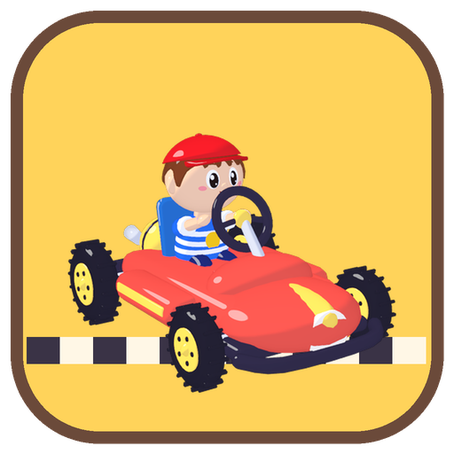
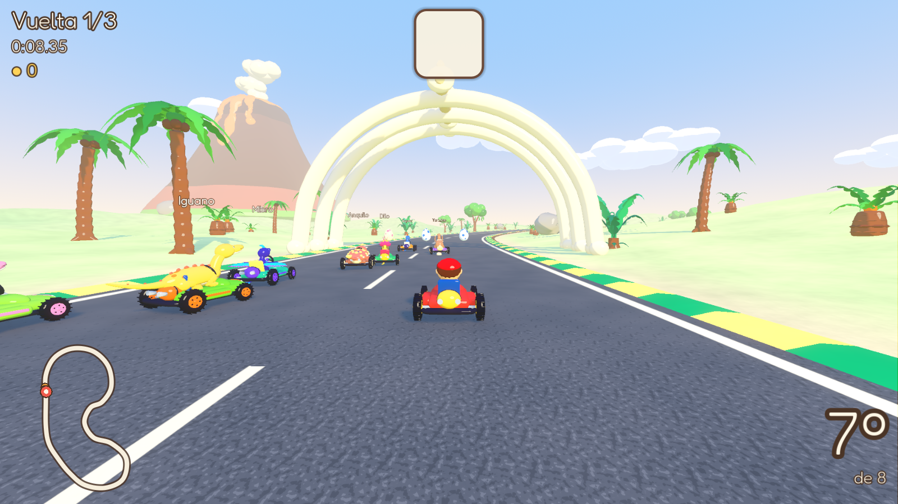
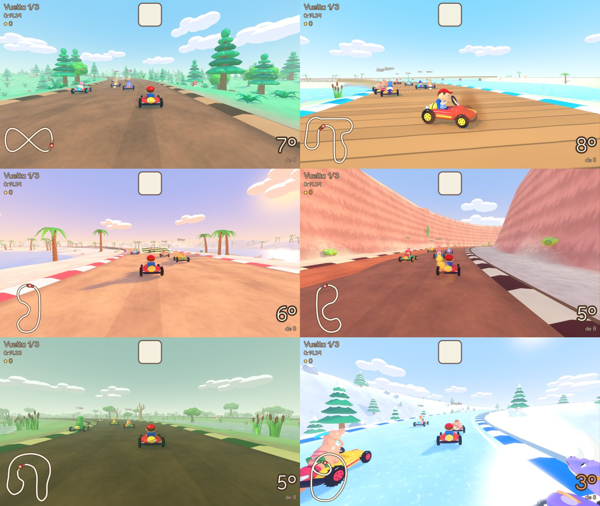
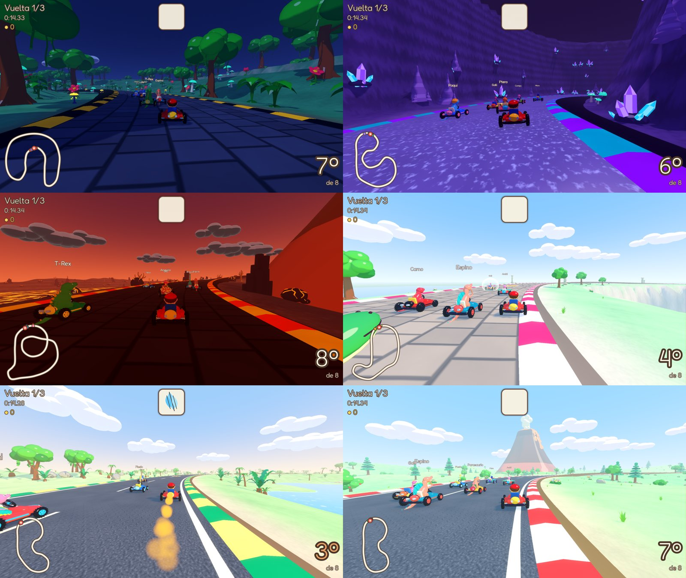
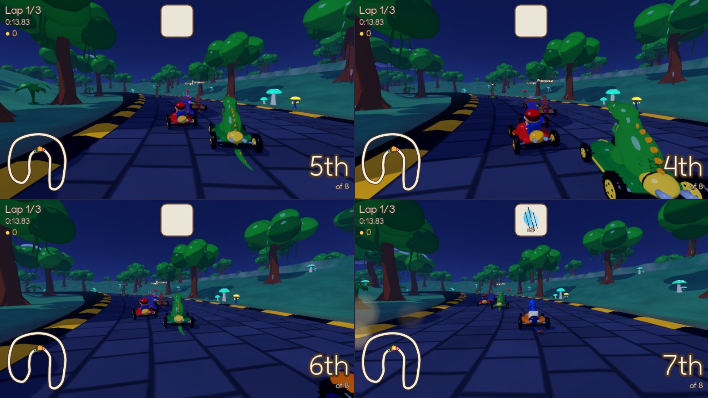

  

<h1 align="center">Tommy's Dino Kart</h1>

  Carreras de karting para chicos (y grandes) con Tommy y los dinosaurios de
  <a href="https://github.com/charliejgallo/TommysDinoZoo">Tommy's Dino Zoo</a>. 
  macOS y Windows · teclado o joysticks · hasta 4 jugadores en una pantalla · castellano e inglés 
  <a href="README.md">Read in English</a>

Elegí a Tommy o a uno de los 20 dinosaurios del zoo y corré contra otros
siete. Todos los pilotos y todas las pistas están abiertos desde el primer
minuto: no hay nada que desbloquear. Las monedas que se juntan en la pista
sólo compran cosas lindas en el garaje (chasis, ruedas y colores).

## Descargar

Bajá **TommysDinoKart-macOS.zip** o **TommysDinoKart-Windows.zip** de la
página de [Releases](https://github.com/charliejgallo/TommysDinoKart/releases).

- **macOS** (Apple silicon e Intel, macOS 11 o más nuevo): descomprimí y
  abrí *Tommy's Dino Kart*. La app no está notarizada: la primera vez hacé
  clic derecho, **Abrir** y otra vez **Abrir** (o permitila en Ajustes del
  Sistema → Privacidad y seguridad).
- **Windows** (64 bits): descomprimí y abrí `TommysDinoKart.exe`. Si
  SmartScreen avisa de una app desconocida: **Más información → Ejecutar de
  todas formas**.

## Qué trae

- **21 pilotos**: Tommy y Tricera, T-Rex, Raptor, Braquio, Ptera, Plesio,
  Archi, Micro, Iguano, Parasaurio, Terizino, Galli, Espino, Dilo, Carno,
  Compy, Estego, Anquilo, Proto y Paqui. Los livianos arrancan rapidísimo,
  los pesados empujan a los demás. Si nadie elige a Tommy, corre de rival.
- **12 pistas en 3 copas**, cada una en su mundo:
  - *Copa Helecho*: Pradera del Zoo, Bosque de Helechos (un ocho con puente
    de troncos), Laguna Turquesa (pasarelas sobre el agua), Playa de los Huevos.
  - *Copa Ámbar*: Cañón Rojo, Pantano Brumoso, Cumbres Nevadas, Selva de Noche.
  - *Copa Volcán*: Cuevas de Cristal, Volcán Rugiente (sobre un lago de
    lava), Acantilado de las Pteras (muy arriba del mar), Valle Rex.
- **4 modos**: Gran Premio (una copa de 4 carreras con puntos y podio),
  Carrera libre, Contrarreloj (tu mejor carrera vuelve como fantasma) y
  Batalla de globos en 4 arenas.
- **Manejo arcade**: mantené el derrape mientras doblás; las chispas se
  ponen azules, naranjas y rosas, y al soltar sale un turbo. Rampas, placas
  de turbo y un truco en el aire (tocá derrape) para un empujoncito.
- **Huevos sorpresa** con ítems: pluma turbo, burbuja, helecho dorado,
  aventón de Ptera… y, si los grandes lo permiten, huevos para tirar,
  charcos de barro y un rugido.
- **Nadie se pierde**: si te caés de la pista o quedás trabado, viene un
  pterodáctilo amigo y te devuelve al camino.

### Ítems

| ítem | qué hace | amable |
|---|---|---|
| Pluma turbo / tres plumas | un empujón de velocidad | ✓ |
| Burbuja | frena el próximo golpe | ✓ |
| Helecho dorado | unos segundos más rápido e intocable | ✓ |
| Aventón de Ptera | un pterodáctilo te lleva volando 3 segundos | ✓ |
| Huevo rebotón / tres huevos | se tira adelante (o atrás frenando), rebota entre los cordones | |
| Huevo buscador | persigue al kart que va adelante | |
| Charco de barro | se deja atrás y hace patinar al que pasa | |
| Rugido | hace girar a los karts que están cerca | |

## Para padres

La página **Para grandes** (con un PIN o una cuenta que sólo un grande
resuelve) permite elegir:

- **Tiempo máximo por sesión**: cuando se cumple, el juego termina la
  carrera y muestra la tarjeta "¡Hora de descansar!"; seguir jugando pide
  la cuenta o el PIN.
- **Ítems**: sólo carreras (sin ítems), sólo ítems amables, o todos.
  **Golpes suaves**: los ítems sólo frenan, nunca hacen girar.
- **Velocidad** para todos: Tortuga, Normal, Rápida o Turbo.
- **Dificultad de los rivales** y **rivales que esperan** a los jugadores.
- **Vueltas por carrera**, si **los karts se empujan**, si aparece el **modo
  batalla** y si se ganan monedas.
- **Ayudas por jugador**: acelerar solo y volante asistido.
- Opcionalmente el PIN protege también los Ajustes; muestra cuánto se jugó hoy.

## Controles

| | Joystick | Teclado (un jugador) | Mitad izquierda | Mitad derecha |
|---|---|---|---|---|
| doblar | palanca / cruz | flechas o A D | A D | ← → |
| acelerar | A | ↑ o W | W | ↑ |
| frenar / marcha atrás | B | ↓ o S | S | ↓ |
| salto + derrape | RB / RT | X, Shift o Espacio | Espacio | Shift derecho o . |
| usar ítem | LB / LT / X | Z, Ctrl o E | E | Enter o , |
| mirar atrás | Y | C | Q | / |
| pausa | Start | Esc | Esc | Esc |

Hasta cuatro jugadores: cada uno aprieta A en su joystick en la pantalla
"¿Quiénes juegan?". Dos pueden compartir un teclado.

## Datos guardados

Ajustes, monedas, karts y fantasmas del contrarreloj se guardan por usuario
en la carpeta de datos de Godot (`~/Library/Application Support/Godot/app_userdata/Tommy's Dino Kart`
en macOS, `%APPDATA%\Godot\app_userdata\Tommy's Dino Kart` en Windows).
Borrarla deja todo como nuevo.

## Para desarrollar

Todo está hecho de texto: los modelos son scripts de Python para Blender,
las pistas son Python que escribe JSON, la música y los sonidos se
sintetizan en Python, y el juego es Godot 4.7. Cómo se arma todo, los
modos de prueba y cómo sumar pilotos, pistas, ítems o idiomas:
[docs/DEVELOPMENT.md](docs/DEVELOPMENT.md) (en inglés). Formato de pistas y
mundos: [docs/TRACKS.md](docs/TRACKS.md).

Licencia MIT ([LICENSE](LICENSE)). Tommy y los dinosaurios vienen de
[Tommy's Dino Zoo](https://github.com/charliejgallo/TommysDinoZoo).
