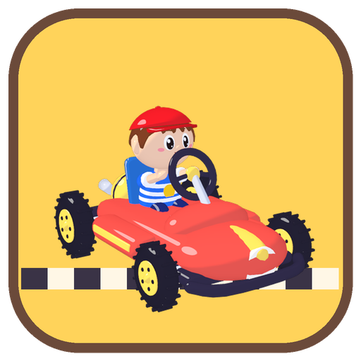
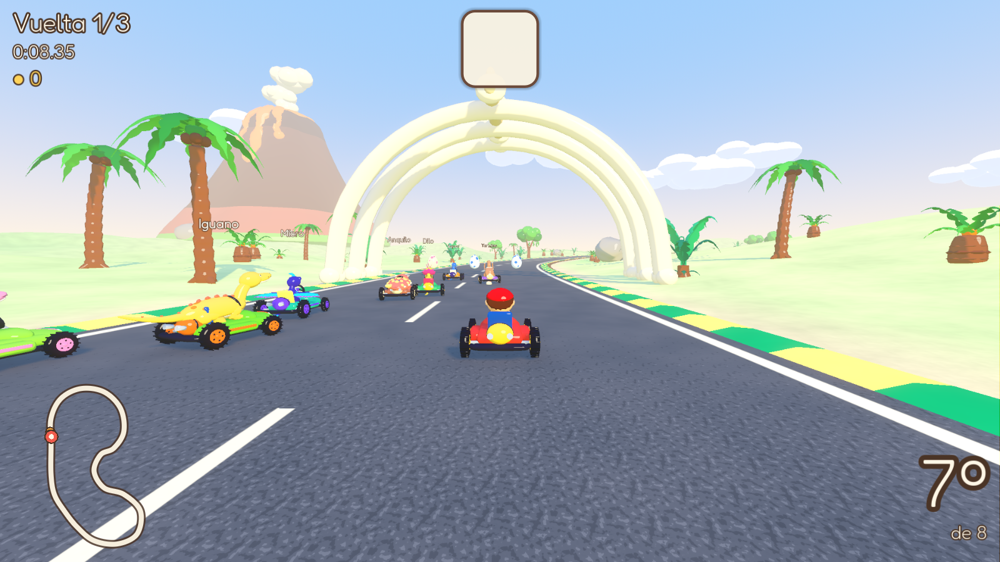
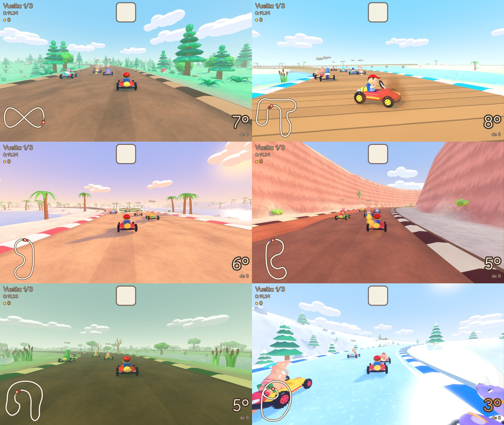
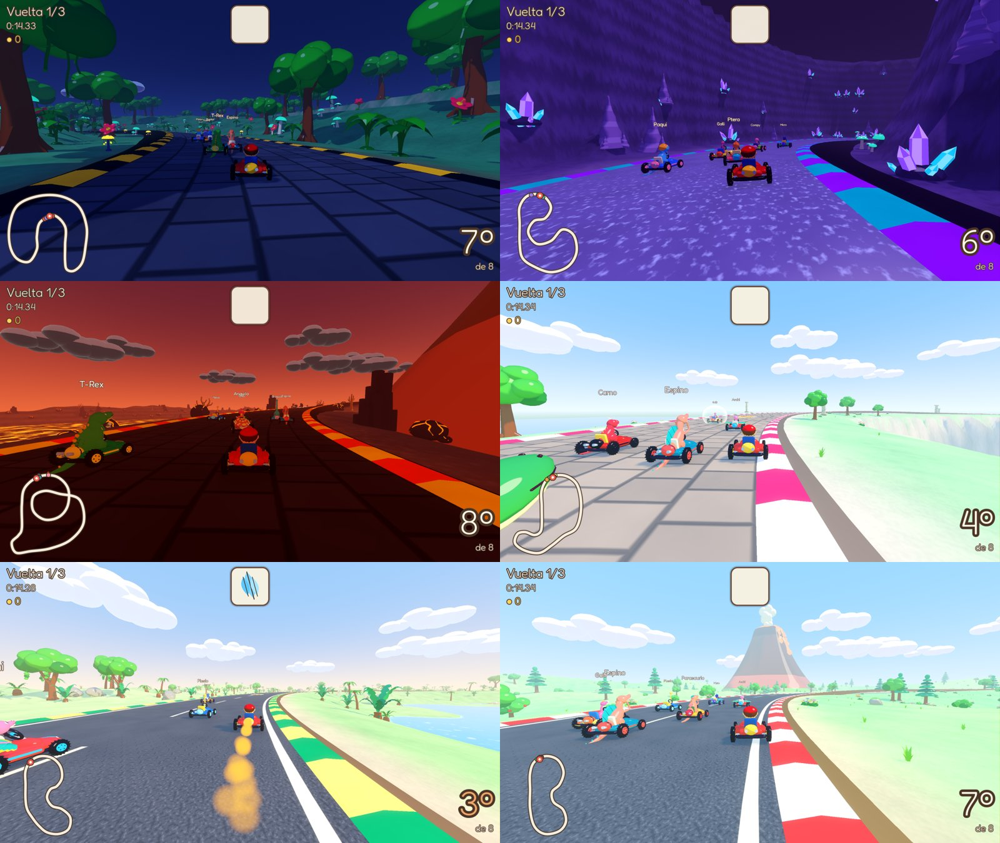
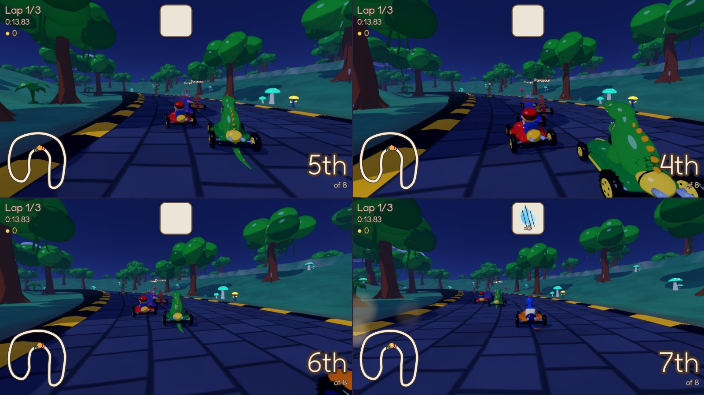

<p align="center">
  
</p>

<h1 align="center">Tommy's Dino Kart</h1>

<p align="center">
  Kart racing for children (and grown-ups) with Tommy and the dinosaurs of
  <a href="https://github.com/charliejgallo/TommysDinoZoo">Tommy's Dino Zoo</a>.<br>
  macOS and Windows · keyboard or gamepads · up to 4 players on one screen · Spanish and English
</p>



Pick Tommy or one of the 20 dinosaurs of the zoo and race against seven
others. Every pilot and every track is open from the first minute: nothing
has to be unlocked. Coins collected on the track only buy looks in the
garage (kart bodies, wheels and colours).

## What's in it

- **21 pilots**: Tommy and triceratops, T. rex, velociraptor, brachiosaurus,
  pteranodon, plesiosaur, archaeopteryx, microraptor, iguanodon,
  parasaurolophus, therizinosaurus, gallimimus, spinosaurus, dilophosaurus,
  carnotaurus, compsognathus, stegosaurus, ankylosaurus, protoceratops and
  pachycephalosaurus. Light, medium and heavy pilots drive a little
  differently. When nobody picks Tommy, he races as a rival.
- **12 tracks in 3 cups**, each in its own world:
  - *Fern Cup*: Zoo Meadow, Fern Forest (a figure of eight with a log
    bridge), Turquoise Lagoon (boardwalks over the water), Egg Beach.
  - *Amber Cup*: Red Canyon, Misty Swamp, Snowy Peaks, Night Jungle.
  - *Volcano Cup*: Crystal Caves, Roaring Volcano (over a lava lake), Ptera
    Cliffs (high over the sea), Rex Valley.
- **4 modes**: Grand Prix (a cup of 4 races with points and a podium), Free
  race, Time trial (your best run comes back as a ghost) and Balloon battle
  in 4 arenas.
- **Arcade driving**: hold drift while turning to slide; the sparks turn
  blue, orange and pink, and letting go gives a turbo. Ramps, boost pads and
  a trick in the air (tap drift) for a little extra.
- **Surprise eggs** with friendly items: feather turbo, bubble shield,
  golden fern, a ride on a pterosaur… and, if the grown-ups allow it, eggs to
  throw, mud puddles and a big roar.
- **Nobody gets lost**: falling off the track or getting stuck calls a
  friendly pterosaur that carries the kart back to the road.




## For parents

The **Grown-ups** page (behind a PIN or a sum only a grown-up can do) sets:

- **Maximum time per session**: when it runs out, the game finishes the race
  and shows a "time for a rest" card; carrying on needs the grown-up gate.
- **Items**: racing only (no items), friendly items only, or all of them.
  **Gentle hits**: items only slow you down, karts never spin out.
- **Speed**: Turtle, Normal, Fast or Turbo for everyone.
- **Rival difficulty** and **rivals that wait** for the players.
- **Laps per race**, whether **karts push each other**, whether the **battle
  mode** shows at all, and whether coins are earned.
- **Help for each player**: auto accelerate and steering help.
- Optionally the PIN also protects the normal Settings, and it shows how long
  the game has been played today.

## Controls

| | Gamepad | Keyboard (one player) | Keyboard left half | Keyboard right half |
|---|---|---|---|---|
| steer | stick / d-pad | arrows or A D | A D | ← → |
| accelerate | A | ↑ or W | W | ↑ |
| brake / reverse | B | ↓ or S | S | ↓ |
| hop + drift | RB / RT | X, Shift or Space | Space | Right Shift or . |
| use item | LB / LT / X | Z, Ctrl or E | E | Enter or , |
| look behind | Y | C | Q | / |
| pause | Start | Esc | Esc | Esc |

Up to four players: each one presses A on their own gamepad on the
"Who's playing?" screen. Two people can share one keyboard.



## Building

Everything is made from text: models are Python scripts for Blender
(`art/blender/`), tracks are Python that writes JSON (`tools/tracks.py`),
sounds and music are synthesised (`tools/audio/`), and the game is Godot
4.7 (`game/`). A tag `v*` makes GitHub Actions build the macOS and Windows
zips.

```
/Applications/Blender.app/Contents/MacOS/Blender -b -P art/blender/drivers.py   # pilots
/Applications/Blender.app/Contents/MacOS/Blender -b -P art/blender/kart.py      # karts
/Applications/Blender.app/Contents/MacOS/Blender -b -P art/blender/scenery.py   # scenery
python3 tools/tracks.py                                                          # tracks
python3 tools/audio/gen_sfx.py && python3 tools/audio/gen_music.py               # audio
godot --path game                                                                # play
godot --headless --path game -- --race=bosque --ai-player --autotest=8          # 8 AIs race a whole cup race
```

MIT licence. The dinosaurs and Tommy come from Tommy's Dino Zoo.
